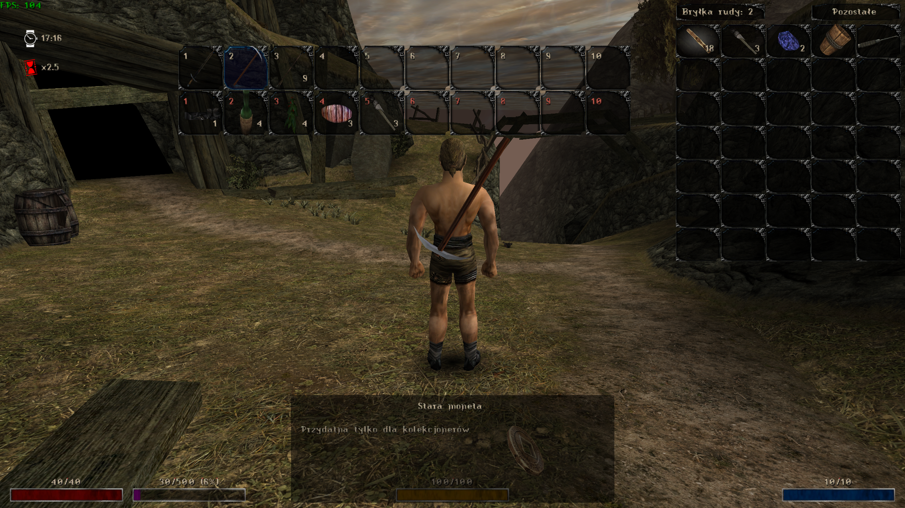

# QuickSlots

[English](README.MD) | **Polski**

Plugin Union do gier Gothic i Gothic II, dodający pasek szybkiego dostępu do przedmiotów i czarów, alternatywne sloty oraz presety wyposażenia.



## Instalacja

1. Zainstaluj Union w katalogu gry.
2. Skopiuj plik **QuickSlots.vdf** do folderu `Data\Plugins` w katalogu gry. Utwórz folder, jeśli jeszcze nie istnieje.

## Funkcjonalności

- Do 20 przypisanych przedmiotów lub czarów: 10 slotów głównych i 10 alternatywnych, obsługiwanych klawiszami **1–0**.
- 4 presety zapisujące przypisania na obu paskach oraz aktualnie założone wyposażenie.
- Konfigurowalna widoczność, położenie, wielkość i tła slotów oraz opcjonalne obracanie aktualnie używanego przedmiotu na pasku.
- Przypisania i presety zapisywane wraz ze stanem gry, w pliku `QuickSlots.sav` w folderze danego zapisu.

## Domyślne sterowanie

**Modifier** to pierwszy boczny przycisk myszy (**MOUSE_XBUTTON1**). Przytrzymaj go podczas używania kombinacji z tabeli.

| Klawisz | W ekwipunku | Poza ekwipunkiem |
| --- | --- | --- |
| **1–0** | Przypisanie zaznaczonego przedmiotu lub czaru do slotu głównego | Użycie przedmiotu lub czaru ze slotu głównego |
| **Modifier + 1–0** | Przypisanie do slotu alternatywnego | Użycie slotu alternatywnego |
| **Modifier + F1–F4** | Zapisanie lub nadpisanie presetu | Wczytanie presetu |
| **Modifier + I** | — | Przełączenie widoczności pasków |

Ponowne przypisanie tego samego przedmiotu do jego obecnego slotu usuwa przypisanie. Przypisanie go do innego slotu przenosi go tam.

W ekwipunku widoczne są oba paski. Poza nim pasek alternatywny zastępuje główny po przytrzymaniu modifiera, chyba że włączono `QSAltBarAlwaysVisible`.

Przed wczytaniem presetu schowaj broń lub magię i poczekaj na zakończenie bieżącej czynności. Między zmianami presetów musi upłynąć co najmniej sekunda. Preset zastępuje bieżące wyposażenie; przedmioty, których nie ma już w ekwipunku, są pomijane.

W **Gothic II**, także w **Nocy Kruka**, klawisz **tyldy (`~`) / grawisu** pozwala wyciągnąć lub schować pięści po włączeniu `QSEnableFistDraw`. Ta funkcja jest domyślnie wyłączona.

Modifier oraz klawisze widoczności i pięści można zmienić w ustawieniach QuickSlots. Klawisze **1–0** i **F1–F4** są stałe.

## Konfiguracja

Ustawienia są dostępne w menu Union → QuickSlots w grze oraz w sekcji `[QUICKSLOTS]` pliku `System\Gothic.ini`. Poniżej znajdują się aktualne wartości domyślne:

```ini
[QUICKSLOTS]
; Wyciąganie pięści skonfigurowanym klawiszem w Gothic II (0 = wyłączone, 1 = włączone)
QSEnableFistDraw=0

; Automatyczne wyciąganie broni po zmianie wyposażonej broni za pomocą slotu
QSDrawWeaponOnSwitch=1

; Stała widoczność paska alternatywnego poza ekwipunkiem
QSAltBarAlwaysVisible=0

; Ukrywanie slotów poza ekwipunkiem:
; 0 = wszystkie sloty widoczne
; 1 = ukryte puste sloty
; 2 = ukryte także sloty z przedmiotami niedostępnymi lub niemożliwymi do użycia
QSHideEmptySlots=0

; Tło wyekwipowanego przedmiotu dla czarów na pasku
QSShowEquippedSpells=0

; Wyświetlanie informacji o sterowaniu pod paskami w ekwipunku
QSShowInfoInInventory=1

; Ukrycie pasków poza ekwipunkiem (zmieniane także skrótem widoczności)
QSHideBar=0

; Położenie pasków poza ekwipunkiem: 0 = dół, 1 = góra
QSSwitchPosY=0

; Obracanie aktualnie używanego przedmiotu na pasku
QSRotateUsedItem=0

; Wielkość slotów w pikselach (ograniczana do dostępnej szerokości ekranu)
QSCellSize=70

; Tło zwykłego slotu
QSInventorySlotTexture=INV_SLOT

; Tło slotu z wyekwipowanym przedmiotem
QSInventorySlotEquippedTexture=INV_SLOT_EQUIPPED

; Tło slotu z aktualnie używanym przedmiotem, np. wyciągniętą bronią
QSInventorySlotActiveTexture=INV_SLOT_HIGHLIGHTED
```

Skróty klawiszowe są przechowywane w sekcji `[KEYS]` jako `keyQSModifierHotkey`, `keyQSSwitchVisibilityHotkey` i `keyQSFistHotkey`. Najprościej zmienić je w menu QuickSlots.

Nadal obsługiwane są również poniższe wpisy ze starszej konfiguracji (przykład z domyślnymi klawiszami). Podczas wczytywania ustawień plugin przenosi je do `[KEYS]`, po czym pozostawia ich wartości w `[QUICKSLOTS]` puste:

```ini
[QUICKSLOTS]
QSModifierHotkey=MOUSE_XBUTTON1
QSSwitchVisibilityHotkey=KEY_I
QSFistHotkey=KEY_GRAVE
```
