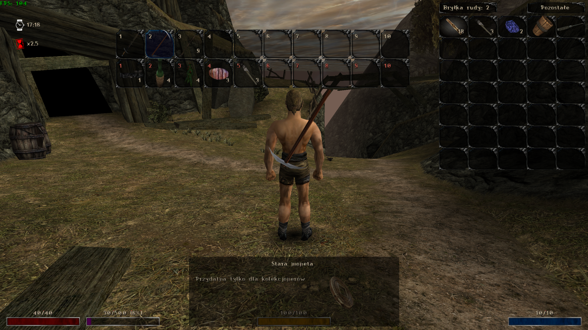

# QuickSlots

**English** | [Polski](README.PL.md)

A Union plugin for Gothic and Gothic II that adds an item and spell hotbar with alternate slots and equipment presets.



## Installation

1. Install Union in your game directory.
2. Copy **QuickSlots.vdf** to `Data\Plugins` inside your game directory. Create the folder if it does not exist.

## Features

- Up to 20 assigned items or spells: 10 main slots and 10 alternate slots, accessed with **1–0**.
- 4 presets that store assignments for both bars and your currently equipped items.
- Configurable visibility, position, slot size and backgrounds, with optional rotation of the item currently in use on the bar.
- Assignments and presets stored with each game save in a `QuickSlots.sav` file in that save's folder.

## Default controls

The **modifier** is the first side mouse button (**MOUSE_XBUTTON1**). Hold it while using the combinations below.

| Key | In the inventory | Outside the inventory |
| --- | --- | --- |
| **1–0** | Assign the selected item or spell to a main slot | Use the item or spell in a main slot |
| **Modifier + 1–0** | Assign to an alternate slot | Use an alternate slot |
| **Modifier + F1–F4** | Save or overwrite a preset | Load a preset |
| **Modifier + I** | — | Toggle bar visibility |

Assigning an item to its current slot again clears the assignment. Assigning it to another slot moves it there.

Both bars are visible in the inventory. Outside the inventory, holding the modifier replaces the main bar with the alternate bar unless `QSAltBarAlwaysVisible` is enabled.

Before loading a preset, put away your weapon or magic and let your current action finish. Allow at least one second between preset switches. Loading a preset replaces your current equipment; saved items that are no longer in your inventory are skipped.

In **Gothic II**, including **Night of the Raven**, the **grave/tilde (`~`) key** draws or puts away your fists when `QSEnableFistDraw` is enabled. This feature is disabled by default.

The modifier, visibility key and fist key can be changed in the QuickSlots settings. The **1–0** and **F1–F4** keys are fixed.

## Configuration

Settings are available in the in-game Union → QuickSlots menu and in the `[QUICKSLOTS]` section of `System\Gothic.ini`. These are the current defaults:

```ini
[QUICKSLOTS]
; Draw fists with the configured key in Gothic II (0 = disabled, 1 = enabled)
QSEnableFistDraw=0

; Automatically draw the weapon when changing the equipped weapon through a slot
QSDrawWeaponOnSwitch=1

; Always show the alternate bar outside the inventory
QSAltBarAlwaysVisible=0

; Hide slots outside the inventory:
; 0 = show all slots
; 1 = hide empty slots
; 2 = also hide slots whose items are unavailable or cannot be used
QSHideEmptySlots=0

; Give spells on the bar the equipped-item background
QSShowEquippedSpells=0

; Show control hints below the bars in the inventory
QSShowInfoInInventory=1

; Hide the bars outside the inventory (also changed by the visibility shortcut)
QSHideBar=0

; Bar position outside the inventory: 0 = bottom, 1 = top
QSSwitchPosY=0

; Rotate the item currently in use on the bar
QSRotateUsedItem=0

; Slot size in pixels (limited to the available screen width)
QSCellSize=70

; Normal slot background
QSInventorySlotTexture=INV_SLOT

; Background for a slot containing an equipped item
QSInventorySlotEquippedTexture=INV_SLOT_EQUIPPED

; Background for a slot containing an item currently in use, such as a drawn weapon
QSInventorySlotActiveTexture=INV_SLOT_HIGHLIGHTED
```

Hotkeys are stored in the `[KEYS]` section as `keyQSModifierHotkey`, `keyQSSwitchVisibilityHotkey` and `keyQSFistHotkey`. The easiest way to change them is through the QuickSlots menu.

The following entries from older configurations are also supported (shown with the default keys). When settings are loaded, the plugin imports them into `[KEYS]` and clears their values in `[QUICKSLOTS]`:

```ini
[QUICKSLOTS]
QSModifierHotkey=MOUSE_XBUTTON1
QSSwitchVisibilityHotkey=KEY_I
QSFistHotkey=KEY_GRAVE
```
